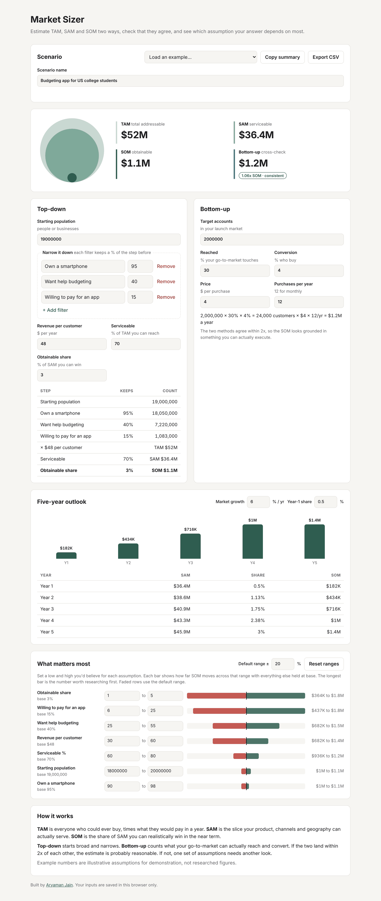

# Market Sizer

A tool for answering the first question in any product or strategy discussion: **how big is this opportunity, really?** Estimate TAM, SAM and SOM top-down, check it against a bottom-up build, project it five years out, and find out which assumption your answer depends on most.

**Live demo:** https://aryamanjain43.github.io/market-sizer/



## Why I built it

Market sizing slides usually show one confident number. The interesting part is everything behind it: which filters you applied, whether a bottom-up view agrees, and which assumption would change the answer if it were wrong. I wanted a tool that makes all of that visible, so a sizing estimate can be challenged and defended instead of just presented.

## Features

- **Top-down funnel:** start from a population, narrow it with as many filters as you need, then apply revenue per customer, serviceable % and obtainable share to get TAM, SAM and SOM
- **Bottom-up cross-check:** build revenue from accounts you can reach, conversion, price and purchase frequency, with an automatic verdict on whether the two methods agree
- **Sensitivity analysis:** set a low and high you'd believe for every assumption and see a tornado chart of how far SOM moves for each, ranked so the biggest uncertainty is on top
- **Five-year outlook:** grow the market at a chosen rate while your share ramps from a year-1 starting point to the target
- **Copy summary** as plain text for a doc, deck or email, or **export to CSV**
- Two worked examples (a B2C app and a B2B SaaS product) and a blank starting point
- Saves in your browser, works on mobile, light and dark mode, no build step and no dependencies

## How the math works

| Step | Formula |
|---|---|
| Customers | Population × filter 1 % × filter 2 % × … |
| TAM | Customers × revenue per customer per year |
| SAM | TAM × serviceable % (what your product, channels and geography can reach) |
| SOM | SAM × obtainable share % (what you can realistically win) |
| Bottom-up | Target accounts × reached % × conversion % × price × purchases per year |

**Cross-check:** if bottom-up revenue is within 2x of top-down SOM, the estimate is marked *consistent*; within 5x is *check*; beyond that is *far apart*, which usually means the obtainable share is optimistic or the go-to-market assumptions are thin.

**Sensitivity:** each assumption is tested at its low and high value while everything else stays at base. Assumptions without a custom range use a default ± swing (20% unless you change it). Percentages never go above 100.

The example scenarios use illustrative assumptions for demonstration, not researched figures.

## Run it locally

```bash
git clone https://github.com/aryamanjain43/market-sizer.git
cd market-sizer
open index.html        # or just double-click it
```

Run the tests (Node 18+):

```bash
npm test
```

## Project structure

```
index.html            Page layout
styles.css            Styling, with light and dark mode
src/sizing.js         TAM/SAM/SOM, bottom-up, projection, sensitivity and summary logic (no DOM, fully tested)
src/app.js            UI wiring, examples and browser storage
test/sizing.test.js   Unit tests for the sizing logic
```

## Ideas for next steps

- Save and compare several scenarios side by side
- Monte Carlo simulation across the ranges to give a probability distribution for SOM
- Cite a source next to each assumption so the estimate carries its own evidence

## License

MIT
